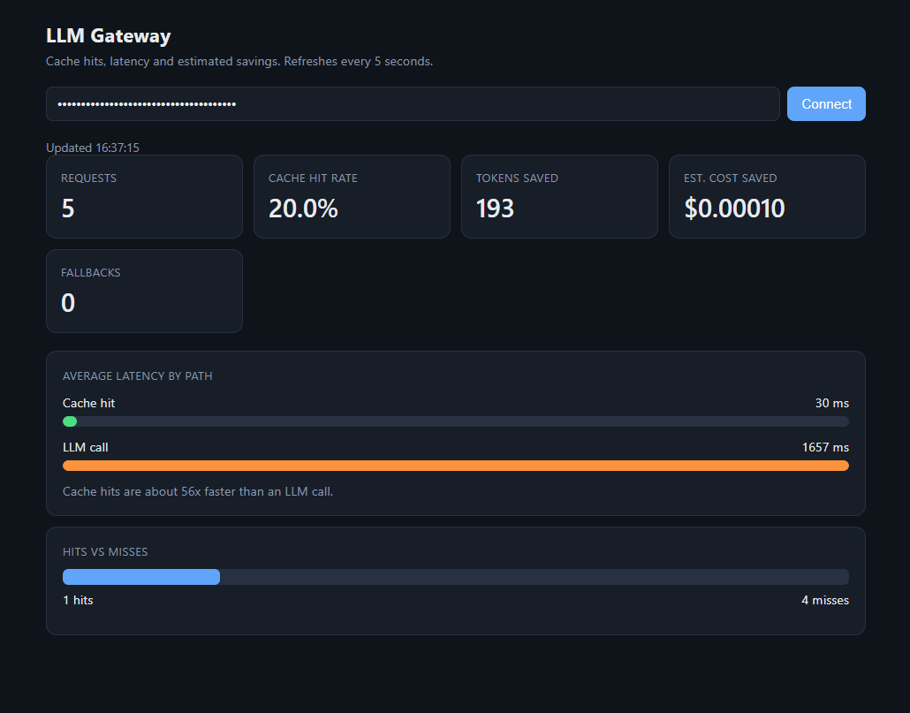

# LLM Smart Gateway

An OpenAI-compatible gateway that sits in front of LLM providers and adds
authentication, rate limiting, automatic fallback, a semantic cache and live metrics.



## What it does

- **Routing with fallback**: requests go to a primary model (Groq, `openai/gpt-oss-20b`).
  If it fails or times out, the gateway switches to a local model (Ollama, llama3)
  and the caller still gets an answer.
- **Semantic cache**: similar questions reuse earlier answers, found by comparing
  sentence embeddings in Qdrant. No LLM call, no cost.
- **Authentication**: per-client API keys, plus a separate admin key for metrics.
- **Rate limiting**: per-client limits per minute and per hour in Redis,
  with `429` and a `Retry-After` header.
- **Metrics and dashboard**: hit rate, tokens saved, estimated cost saved,
  latency per path, fallback count.

## Request flow

```
client -> API key check -> rate limit -> semantic cache --hit--> answer
                                              |
                                             miss
                                              v
                              primary model (Groq) --fails--> fallback (Ollama)
                                              |
                                      save to cache + record metrics
```

## Measured latency

| Path | Latency |
|---|---|
| Local llama3 fallback (CPU laptop) | ~55 s |
| Groq primary | ~1.3 s |
| Semantic cache hit | ~30-65 ms |

In a test run of 14 requests, the cache answered 43% of them and was about 18x faster
than an LLM call.

## Run it

```bash
cp .env.example .env        # then fill in your keys
docker compose up --build   # gateway + Redis + Qdrant
```

- Gateway: `http://localhost:8000` (API docs at `/docs`)
- Dashboard: `http://localhost:8000/dashboard` (enter the admin key)
- Ollama must run on the host for the fallback (`ollama run llama3`).

On Windows PowerShell, use `Copy-Item .env.example .env` instead of `cp`.

Example request:

```bash
curl -X POST http://localhost:8000/v1/chat/completions \
  -H "Authorization: Bearer YOUR_CLIENT_KEY" \
  -H "Content-Type: application/json" \
  -d '{"messages":[{"role":"user","content":"What is Redis?"}]}'
```

Metrics (admin key only): `GET /v1/metrics`

## Configuration

All settings live in `.env` (see `.env.example`). The main ones:

| Setting | Purpose |
|---|---|
| `GROQ_API_KEY` | Key for the primary provider |
| `CLIENT_API_KEYS` | Allowed callers, as `key:name` pairs separated by commas |
| `ADMIN_API_KEY` | Key for `/v1/metrics` and the dashboard |
| `PRIMARY_MODEL` | Model used on the primary provider |
| `FALLBACK_LLM_URL`, `FALLBACK_MODEL` | Local fallback (Ollama) |
| `SIMILARITY_THRESHOLD` | Minimum cosine similarity for a cache hit (default 0.93) |

## Tests

```bash
pip install -r requirements-dev.txt
python -m pytest tests -v
```

16 tests cover authentication, rate limiting, the cache guards, the cache-hit and
fallback paths, and admin-only metrics. Redis, Qdrant and the LLM providers are
mocked, so the tests are fast and free.

## Design notes and known limits

- **Similarity threshold (0.93)** was tuned on paraphrase and near-miss pairs.
  Real paraphrases scored 0.87-0.94, but opposites such as "enable"/"disable"
  scored up to 0.93, so no single threshold separates them.
- **Guards** reject a cache hit when the two questions contain different numbers,
  opposite words (enable/disable, add/remove...) or a negation. The list of
  opposites is finite, so some meaning changes can still slip through.
  A cross-encoder re-ranker would be the next improvement.
- The cache key is the last user message only, and the cache is shared across clients.
- Cost savings are an estimate based on a flat price per 1K tokens.
- Streaming responses are not supported.
- Metrics are global, not per client.
- Answers are capped at `MAX_COMPLETION_TOKENS` (4096 by default). A truncated answer is reported with `finish_reason: length` and is never stored in the cache.

## Project layout

```
app/
  api/v1/endpoints/   chat and metrics endpoints
  core/               config, API-key security, rate limiter
  models/             request and response models
  services/           LLM router, embeddings, semantic cache, metrics
  static/             dashboard page
tests/                pytest suite
scripts/              threshold tuning script
docker-compose.yml    gateway + Redis + Qdrant
```
